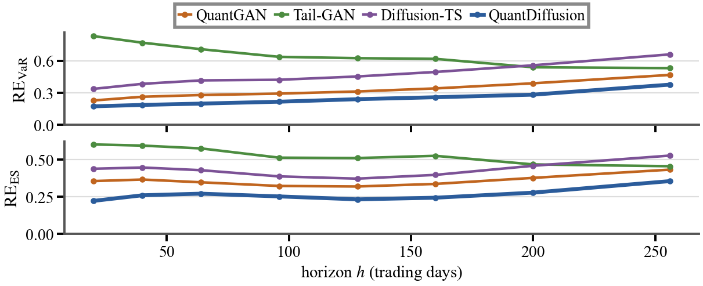
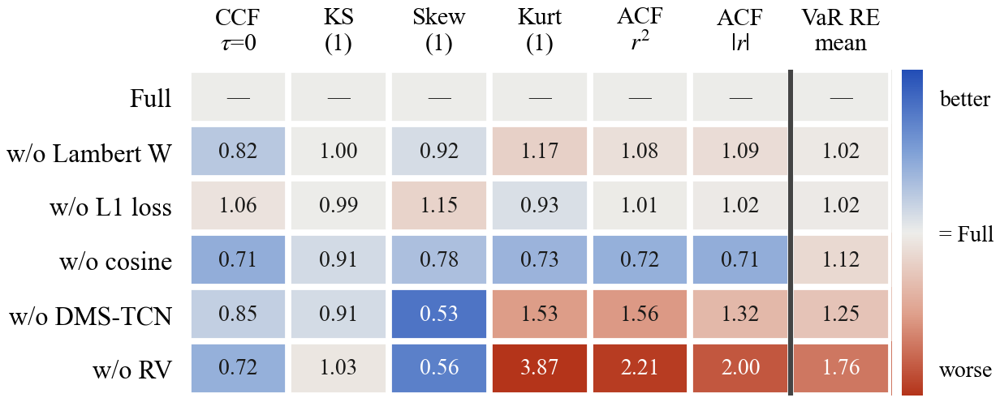

# QuantDiffusion (ICAIF 2026)

This is the official implementation of the paper: **QuantDiffusion: Deep Generation of Multivariate
Financial Scenarios for Portfolio Risk Assessment**.

---

## Our Paper 

*QuantDiffusion: Deep Generation of Multivariate Financial Scenarios for Portfolio Risk Assessment.*
In the 7th ACM International Conference on AI in Finance (ICAIF), 2026. Author list withheld for review.

We study how to make **denoising diffusion models** generate realistic multivariate financial return
scenarios for risk-sensitive tasks (stress testing, deep hedging, Value-at-Risk / Expected Shortfall
estimation), where reproducing the **tail** of the distribution matters as much as the bulk.

GAN-based generators reproduce stylized facts but admit no stochastic-process (SDE) interpretation, whereas
diffusion models are intrinsically SDEs but fail to model ordinary and tail events simultaneously. Reading
diffusion training as **Langevin dynamics**, we show that a stochastic-volatility process leaves a Brownian
footprint indistinguishable from the injected diffusion noise, and we remove this conflation by extracting the
volatility component **before** training. The resulting model stays coherent with a **stochastic volatility
jump diffusion (SVJD)** reading of returns, and improves cross-asset dependence, marginal distributions
across horizons, volatility clustering, and portfolio-level VaR/ES over state-of-the-art baselines.

**Contributions.**
1. The first to connect diffusion-model training with the SDE representation of financial time series, and a
   **realized-volatility decomposition** that models bulk and tail stably and concurrently.
2. An SDE-level (Itô-based) treatment of the **Lambert *W*** Gaussianization that isolates the jump component
   and restores stochastic-process interpretability, supporting the SVJD specification a posteriori.
3. A **DMS-TCN** backbone with dilated causal convolutions and parallel large/small-kernel branches for local
   and long-horizon dependence, which lowers portfolio VaR/ES error by up to 22.4% relative to the variant
   without it.

## QuantDiffusion Pipeline


Each return is factored into a standardized shock `z` and a volatility magnitude `√RV`, and the diffusion model
only ever sees the components:

```
Real returns  r ∈ R^{n×T}
      │   RV decomposition:  r_t = z_t · √RV_t     (RV = 10-day close-to-close realized variance)
      ▼
   (z, log RV) ∈ R^{2n×T}
      │   Normalize  →  inverse Lambert W (Gaussianize)  →  Normalize
      ▼
   Forward noising  q(x_t | x_{t-1})           DDPM, Gaussian noise, cosine schedule
      │   Reverse  p_θ(x_{t-1} | x_t)           score network = DMS-TCN
      ▼
   (ẑ, log R̂V)  →  Denormalize → Lambert W → Denormalize
      │   Recomposition:  r̂_t = ẑ_t · exp(log R̂V_t)
      ▼
Synthetic returns  r̂ ∈ R^{n×T}
```

- **RV decomposition** decouples the coupled `(r, v)` SDE (via Itô) so the shock channel's diffusion depends
  only on `z`, flattening the energy landscape and stabilizing reverse-time Langevin dynamics. Statistically,
  `r = z·√RV` mirrors a Student-*t* variate, realizing a **dynamic Student-*t*** with a learned scale process.
- **Lambert *W*** Gaussianization tames the heavy tail of `z`; being `C²` and invertible, it acts at the SDE
  level (suppressing the jump term) rather than as a preprocessing heuristic.
- **DMS-TCN** (`models/DMS_TCN.py`, class `DMSTCN`): large-kernel branch (kernels `[15, 7, 5]`, dilations
  `[1, 4, 16]`) + small-kernel branch (`[5, 5, 5]`, dilation 1), fused for multi-scale temporal structure;
  `dims = [128, 128, 128]`, sinusoidal time embedding, no cross-attention.
- **Diffusion**: Gaussian DDPM, `ε`-prediction, smooth-`ℓ1` loss, cosine schedule (`τ=1.5`,
  `β∈[1e-5, 0.5]`, `T=75`), EMA `0.9999`. Trained 45 epochs, Adam `lr=2e-4`, `weight_decay=1e-5`, batch 256.
  The checkpoint is the epoch with the lowest 100-day EMD against the training data.
  (`modules/diffusion.py` also implements Student-*t* and joint Student-*t* forward noise; the reported model
  uses `sampling_type="gaussian"`.)

## Main Results

Real daily returns for six assets (DJIA, Nasdaq, JP Morgan, Hang Seng, Gold, WTI crude),
2001-01-02 to 2025-12-30, evaluated against **QuantGAN, Tail-GAN, and Diffusion-TS**. Each model draws
five batches of 2,000 scenarios in `R^{6×256}`, one per seed. Fidelity entries are the mean ± std over the
five seeds; risk entries are scored on ten evaluation baskets and reported as the mean ± std over the
ten per-basket values (each already averaged over the five seeds).

Best in **bold**, second best in *italic*; lower is better. Every number below is read straight out of
`result/statistics/*.csv`, which the notebooks regenerate.

### Generation fidelity

| Metric | QuantDiffusion | QuantGAN | Tail-GAN | Diffusion-TS |
|---|---|---|---|---|
| CCF(τ=0) | *0.0533* | 0.1260 | 0.1930 | **0.0529** |
| CCF(τ>0) | *0.0365* | 0.0919 | 0.0804 | **0.0355** |
| Vol CCF(τ=0) | *0.0909* | 0.2313 | 0.3273 | **0.0604** |
| KS(1) | **0.0378** | *0.0490* | 0.1515 | 0.1059 |
| KS(5) | **0.0459** | *0.0709* | 0.1257 | 0.1232 |
| KS(20) | **0.0618** | *0.1181* | 0.1489 | 0.1533 |
| KS(100) | **0.1626** | *0.2130* | 0.2695 | 0.2251 |
| Skew(1) | *0.1993* | 0.7088 | 0.2423 | **0.1254** |
| Skew(5) | 0.3866 | 0.4150 | *0.3434* | **0.1693** |
| Skew(20) | 0.3753 | *0.2851* | 0.3486 | **0.2282** |
| Skew(100) | 0.1157 | **0.0752** | 0.2651 | *0.0959* |
| Kurt(1) | **0.7085** | 3.1378 | 4.7732 | *2.9523* |
| Kurt(5) | *1.0368* | **0.8554** | 1.5584 | 1.0709 |
| Kurt(20) | **0.2621** | *0.5771* | 0.7279 | 0.6937 |
| Kurt(100) | **0.1872** | *0.2240* | 0.3748 | 0.2538 |
| ACF(x) | *0.0009* | 0.0044 | 0.0029 | **0.0007** |
| ACF(\|x\|) | **0.0016** | 0.0047 | 0.0060 | *0.0041* |
| ACF(x²) | **0.0009** | 0.0028 | 0.0037 | *0.0023* |
| Leverage | **0.0008** | 0.0016 | 0.0033 | *0.0013* |

QuantDiffusion is best on 10 of the 19 fidelity metrics and top-2 on 16. Diffusion-TS leads on all three
cross correlation rows and on three of the four skewness horizons; QuantDiffusion leads on every KS horizon,
on kurtosis at `h ∈ {1, 20, 100}`, and on all three clustering metrics.

### Portfolio risk, out of sample (real = test split)

| Metric | QuantDiffusion | QuantGAN | Tail-GAN | Diffusion-TS |
|---|---|---|---|---|
| RE VaR(0.05) | **0.3767** | *0.4673* | 0.5306 | 0.6590 |
| RE VaR(0.025) | **0.3572** | *0.4286* | 0.4808 | 0.5525 |
| RE VaR(0.01) | **0.3685** | 0.4343 | *0.4329* | 0.4771 |
| RE ES(0.05) | **0.3555** | *0.4326* | 0.4556 | 0.5271 |
| RE ES(0.025) | **0.3598** | *0.4382* | 0.4451 | 0.4729 |
| RE ES(0.01) | **0.3779** | 0.4600 | 0.4631 | *0.4294* |

QuantDiffusion attains the smallest error at every confidence level, improving on the best baseline of each
entry by 19.4% / 16.7% / 14.9% on VaR and 17.8% / 17.9% / 12.0% on ES.

### Portfolio risk, in sample (real = train split)

| Metric | QuantDiffusion | QuantGAN | Tail-GAN | Diffusion-TS |
|---|---|---|---|---|
| RE VaR(0.05) | 0.4120 | *0.4081* | **0.1433** | 0.5055 |
| RE VaR(0.025) | 0.4138 | *0.3838* | **0.1573** | 0.4633 |
| RE VaR(0.01) | 0.3944 | *0.3693* | **0.1882** | 0.4154 |
| RE ES(0.05) | 0.3961 | *0.3787* | **0.1655** | 0.4423 |
| RE ES(0.025) | 0.3827 | *0.3695* | **0.1945** | 0.4153 |
| RE ES(0.01) | *0.3549* | 0.3667 | **0.2315** | 0.3886 |

Tail-GAN is the informative comparison. Its adversarial objective *is* the quantile loss of the risk
statistics, so in sample it dominates every model by a wide margin. None of that survives out of sample: it
buys second place at `α = 0.01` on VaR and nothing further, while remaining the weakest of the four on
kurtosis, on the volatility cross correlation, and on every clustering metric. Distributional fidelity and
tail-risk fidelity are distinct objectives, and QuantDiffusion is the only model here that leads on both.

### Risk across horizons and strategies



`fig4` reads the same relative error at every horizon `h ∈ {20, 40, 64, 96, 128, 160, 200, 256}`, pooled over
the 68 P&L columns `Compute_PNL` produces; `h = 256` reproduces the table above. QuantDiffusion is lowest at
every horizon on both VaR and ES. Tail-GAN is the weakest at short horizons and Diffusion-TS degrades as the
horizon grows, so the ordering of the baselines depends on `h` while QuantDiffusion stays below all three.
`fig6` resolves the same errors into the four strategy blocks (buy and hold `n=6`, static portfolios `n=50`,
mean reversion `n=6`, trend following `n=6`); averaged over horizons, QuantDiffusion is lowest in all eight
cells.

### Ablation

Removing one component at a time from the full model (best in **bold**, second best *italic*; lower is
better). The tags are `baseline`, `a2_wo_rv`, `a2_wo_lambertw`, `a2_wo_moderntcn`, `a2_wo_l1`, `a2_wo_cosine`.

**Portfolio risk, out of sample**

| Metric | Full | w/o RV Decomp. | w/o Lambert W | w/o DMS-TCN | w/o L1 loss | w/o cosine |
|---|---|---|---|---|---|---|
| RE VaR(0.05) | **0.3767** | 0.6764 | 0.3845 | 0.4857 | *0.3813* | 0.4351 |
| RE VaR(0.025) | **0.3572** | 0.6428 | 0.3661 | 0.4506 | *0.3646* | 0.4026 |
| RE VaR(0.01) | **0.3685** | 0.6226 | 0.3780 | 0.4414 | *0.3745* | 0.3916 |
| RE ES(0.05) | **0.3555** | 0.6357 | 0.3660 | 0.4462 | *0.3611* | 0.3941 |
| RE ES(0.025) | **0.3598** | 0.6170 | 0.3706 | 0.4306 | *0.3653* | 0.3777 |
| RE ES(0.01) | *0.3779* | 0.5933 | 0.3834 | 0.4092 | 0.3843 | **0.3603** |

Relative to the full model: removing the RV decomposition costs **57.0% to 79.9%**, removing the DMS-TCN
backbone **21.4% on average**, the linear schedule **5.0% to 15.5%** on five of six entries, the Lambert *W*
transform **1.5% to 3.0%**, and `ℓ2` in place of smooth-`ℓ1` **1.6% on average**. The one entry the full model
does not win is `RE ES(0.01)`, where the linear schedule is lower; over the ten baskets the full model is best
on that entry in one, so the gap belongs to the schedule rather than to the basket draw.

**Generation fidelity** (reported for completeness; the paper's ablation table covers portfolio risk only,
which is the objective the design targets). Read as a heat map rather than a table, since what the ablation
asks is how each variant moves *relative to the full model*: every cell is the ratio of that variant's error
to the error of Full, whose own row is therefore the blank reference, with blue below `1.00` (better than Full)
and red above it. The last column, ruled off, is the same ratio on the mean of the three VaR levels of the risk
table above.



Two readings come out of it. First, the risk column is red for **every** variant (`1.02` to `1.76`), while the
fidelity block is mixed and blue in about half of its cells: several variants are better than Full on fidelity
and all of them are worse on risk. The two are distinct axes, which is why the paper's ablation reports risk.
Removing the cosine schedule is the clean case: it improves all six fidelity cells (`0.71` to `0.91`) and still
costs `1.12` on VaR. Second, the RV decomposition
is where the two axes agree. Removing it is the worst column on risk (`1.76`) and the worst anywhere on the
tail and clustering metrics, inflating daily kurtosis error by `3.87×` and the autocorrelation of `r²` and
`|r|` by `2.21×` and `2.00×`; removing the DMS-TCN backbone is the second worst on both (`1.25` on VaR,
`1.32×` to `1.56×` on clustering). Skewness is the one column where both of those variants beat Full (`0.56`
and `0.53`), and it is the known weak axis of the representation rather than a win for them: dividing by the
realized volatility leaves the innovation channel close to symmetric, so marginal asymmetry has to be rebuilt
through the dependence between the two channels.

The full nineteen metrics for all six columns are in `result/statistics/ablation__gen_quality.csv`;
`python utils/make_paper_tables.py ablation` renders them as the LaTeX table.

## Get Started

**1. Install dependencies.**

```bash
pip install -r requirements.txt
```

Install the PyTorch build that matches your CUDA. The main model / QuantGAN / Tail-GAN were run on
`torch==1.9.0+cu111`; the Diffusion-TS baseline uses PyTorch 2.x.

**2. Get results.** Open a notebook (`1_ablation_study.ipynb`, `2_benchmark.ipynb`, `3_visualization.ipynb`)
and run it top to bottom. The generation stage is **tiered**, so what you get depends on what you delete first:

| Starting point | What happens when you run the notebook |
|---|---|
| **Run as-is** | reuses the existing synthetic data and **prints the results** |
| **Delete** `result/statistics/synthetic_data/<tag>/*.npy` | **regenerates** scenarios from the saved weights, then results |
| **Also delete** `result/statistics/synthetic_data/<tag>/quantDiffusion_best*.pt` | **trains from scratch**, then generates, then results |

`<tag>` is `baseline` for QuantDiffusion and `a2_wo_rv` / `a2_wo_lambertw` / `a2_wo_moderntcn` / `a2_wo_l1` /
`a2_wo_cosine` for the ablations. So: run to reproduce, delete the `.npy` to re-sample, delete the weights to
retrain. Each ablation carries one weight per seed (`quantDiffusion_best_seed{s}({epoch}).pt`), and generation
reseeds at `1000 + seed`, separately from training.

Notebooks 1 and 2 share the `baseline` folder: the QuantDiffusion column of the benchmark and the Full column
of the ablation are the same five batches, so the two tables cannot disagree.

**3. Retrain the baselines.** QuantGAN, Tail-GAN, and Diffusion-TS are trained from their own scripts under
`modules/`; rerun `2_benchmark.ipynb` afterwards to compare against the freshly generated baselines.

```bash
python modules/QuantGAN/run.py       # QuantGAN
python modules/diffusionTS/run.py    # Diffusion-TS

# Tail-GAN. The reported column comes from this command.
python modules/TailGAN/run.py --train --sets 5 --ensemble 1 --epochs 2000 \
    --lr-g 1e-4 --lr-d 1e-5 --d-warmup 400 --lr-d-warmup 1e-3 --select vares
```

> **Tail-GAN does not train at its published defaults on this data, so `run.py` grew four flags.** The
> generator's loss is `S(D(fake), real PnL)`, so it only carries signal once the discriminator is a working
> VaR/ES estimator. The discriminator's own objective is `real_score - fake_score`, which it can lower by
> inflating `fake_score` instead of becoming accurate, and at `lr_D <= 1e-5` that is what happens: it stays at
> its random initialization, and from a random critic the generator's loss *falls monotonically in the generated
> volatility*, telling it to be more extreme without bound. Measured here: `loss_G` 8.43 at 0.2x volatility down
> to 8.35 at 2x, against an attainable floor of 2.11, with per asset standard deviations frozen at 0.027 for all
> six assets. `--d-warmup 400 --lr-d-warmup 1e-3` trains the critic alone first, which reaches the floor
> (1.90 against 1.89) in a hundred steps and turns the generator's loss into a bowl whose minimum sits at the
> real volatility. `train_single_warm` in `run.py` also logs `real_score` and the empirical floor separately,
> which the upstream logging hides by reporting only their difference.
>
> The ten model ensemble of the original paper was also run (`--ensemble 10`). Screening dropped four collapsed
> models and both the original criterion and the `--screen-by min` variant kept the same five, but pooling five
> generators was worse than the single model on **all six** risk entries, by 8% to 29%, because mixing
> heterogeneous generators widens the pooled distribution and inflates the tail quantiles. The reported column is
> therefore the single generator, chosen on the training data selection criterion Tail-GAN itself defines
> (`vares` 0.0886 against 0.0938 to 0.1173 for the ensemble members), not on test numbers.

**4. Portfolio VaR/ES artifacts.** The Tail-GAN style risk metric needs the rolling-window CSVs under
`modules/TailGAN/gan_data/indices2_6d`. They are **built automatically** the first time you run
`1_ablation_study.ipynb` or `2_benchmark.ipynb` (`build_windows()`, imported from `modules/TailGAN/run.py`);
the thresholds are computed on first use. No separate step is required.

> **The transition matrix is the evaluation basket, so it is version controlled.** Fifty of the sixty eight
> P&L columns in `Compute_PNL` are static portfolios drawn by `Gen_StaticPort`, which samples from an unseeded
> normal. Drawing a new matrix rescores **every** model at once, including models that were not retrained, and
> by enough to matter: an accidental redraw once moved a baseline's `RE_VaR(0.05)` by more than 0.08 from byte
> identical samples. The reported numbers therefore average over **ten fixed baskets**, tracked at
> `data/our_basket/basket{0..9}/TransMat_{IS,OOS}.npy`. `utils/tailgan_direct.compute_pnl_direct` takes the
> matrix as an argument, so each basket is read from its own path with no copy into a live slot; it is verified
> bit-for-bit against `TG.Compute_PNL`. A seed alone would not be enough, since `scipy.sparse.random` is not
> guaranteed stable across scipy versions. The reported risk numbers reproduce only against these baskets, and
> every number in the tables moves if they are replaced.
>
> `tailgan_eval.configure_from_project` still prints a warning about drawing a fresh basket into
> `data/tailgan_basket/`. That path is the *live slot* of the upstream code and is unused here: the evaluation
> never reads it, so the warning is harmless.

**5. Figures & data check.** `3_visualization.ipynb` renders the paper figures via `utils.make_paper_figures`
(one cell per figure) into `result/images/`, and cross-checks the CRSP dataset against yfinance.

The figures are sized for `acmart` sigconf (3.33 in for one column, 7.0 in across both) at 400 dpi. Section
3-1 of `3_visualization.ipynb` calls the same builders the command line uses, so the notebook and the pdf
cannot show different plots.

```bash
python utils/make_paper_figures.py          # fig1, fig2, fig4, fig6, fig7, fig8
python utils/make_paper_figures.py 2 4      # only fig2 and fig4
python utils/make_paper_tables.py           # the two fidelity tables, as LaTeX into scratch/
```

| File | Content |
|---|---|
| `fig1_stylized_facts.png` | ACF of \|r\| and r², and the CDF of cross asset comovement of the volatility channel over scenarios |
| `fig2_distribution.png` | five day cumulative log return distributions for JP Morgan |
| `fig4_risk_horizon.png` | VaR/ES error at every horizon from 20 to 256 trading days |
| `fig_framework.png` | the framework figure under QuantDiffusion Pipeline, exported from the slide deck rather than generated by this script |
| `fig6_risk_horizon_strategies.png` | the same error resolved by trading strategy block |
| `fig7c_heatmap.png` | ablation generation fidelity as the ratio to the full model |
| `fig8_regime_tails.png` | 100 day cumulative log returns of HSI, training and QuantDiffusion against the test windows |

`fig4` needs Tail-GAN's `Compute_PNL`, which corrupts the heap on CPU: the P&L values come out correct, then the
process dies at whatever allocates next. Each horizon is therefore computed in a subprocess that writes its
result and leaves through `os._exit`, cached under `result/images/figures/pnl_cache/`, which is safe to delete
and is what makes a restyle take one second instead of two minutes. **Delete the cache after the synthetic
samples change**, or fig4/fig6 will keep showing the old numbers. Set `CUDA_VISIBLE_DEVICES=-1` to keep it
off a busy GPU.

**6. Noise schedule (optional).** `ANT_score.ipynb` scores noise schedules with the ANT criterion; this is how
the cosine schedule was selected.

### Data sources

`0_data.ipynb` assembles `data/indices.csv` from two sources: the five index and commodity series
(`^DJI`, `^IXIC`, `^HSI`, `GC=F`, `CL=F`) come from **Yahoo Finance** via `data/indices/indices_{O,H,L,C,V}.csv`,
and **JP Morgan** comes from **CRSP** (`data/JPM.csv`, `DlyOpen`/`DlyHigh`/`DlyLow`/`DlyClose`/`DlyVol`).

Section 3-2 of `3_visualization.ipynb` plots the panel against a fresh yfinance download. Note what that
comparison can and cannot establish: the five Yahoo series match with `max_rel_diff = 0.00000` because they
were downloaded from the same place, so the check is only meaningful for **JPM**, the one CRSP series, which
shows `max_rel_diff = 0.011` against Yahoo's adjusted close (source/adjustment conventions).

## Repository layout

```
quantDiffusion/
├── 0_data.ipynb             # assemble data/indices.csv and the RV estimators
├── 1_ablation_study.ipynb   # QuantDiffusion (baseline) + 5 ablations: train / generate / evaluate
├── 2_benchmark.ipynb        # QuantDiffusion vs QuantGAN / Tail-GAN / Diffusion-TS
├── 3_visualization.ipynb    # the paper figures + CRSP-vs-yfinance check
├── ANT_score.ipynb          # ANT noise-schedule scoring
├── models/                  # DMS_TCN.py (DMSTCN), quantTCN.py
├── modules/                 # diffusion.py + baselines (QuantGAN, TailGAN, diffusionTS)
│   ├── TailGAN/tailgan_eval.py    # portfolio VaR/ES metric
│   └── TailGAN/gan_data/          # rolling windows, auto-built by the notebooks
├── utils/                   # metric.py, file_manager.py, gaussianize.py, tailgan_direct.py,
│                            #   ANT_utils.py, make_paper_figures.py + make_figures.py
│                            #   + make_square_figures.py (paper figures),
│                            #   make_paper_tables.py (the fidelity tables as LaTeX)
├── data/                    # indices.csv (CRSP), indices/ (OHLCV), RV/, JPM.csv,
│                            #   our_basket/basket{0..9}/ (the ten evaluation baskets)
└── result/
    ├── statistics/          # synthetic_data/<tag>/{0..4}.npy + weights, and the six summary CSVs
    └── images/              # the paper figures; drawio/ sources and figures/ helpers are untracked
```

The six summary CSVs are `ablation__gen_quality.csv`, `ablation__tailgan_vares.csv`,
`ablation__tailgan_vares_IS.csv` and the matching `benchmark__*.csv`. No per-model CSV is written; the mean and
std live in the summary tables.

`result/images/drawio/`, `result/images/figures/` (which holds `pnl_cache/`) and `scratch/` are not tracked.

## Code ↔ paper mapping

| Paper | Code |
|---|---|
| QuantDiffusion (ours) | tag `baseline`, RV = Close-to-Close, window = 10 |
| RV decomposition `r = z·√RV` | `fit_transform_garch_12d` (in `1_ablation_study.ipynb`), `_fit_scalers` (in `2_benchmark.ipynb`) |
| Lambert *W* Gaussianization | `utils/gaussianize.py`, `scaling`/`inverse_scaling` in `utils/utils.py` |
| DMS-TCN | `models/DMS_TCN.py` (`DMSTCN`) |
| Diffusion (DDPM, Gaussian noise, cosine schedule) | `modules/diffusion.py` |
| Ablations | tags `a2_wo_rv` / `a2_wo_lambertw` / `a2_wo_moderntcn` / `a2_wo_l1` / `a2_wo_cosine` |
| Portfolio VaR/ES | `modules/TailGAN/tailgan_eval.py`, `utils/tailgan_direct.py` |
| Statistical fidelity metrics | `utils/metric.py` |
| ANT noise schedule | `ANT_score.ipynb`, `utils/ANT_utils.py` |
