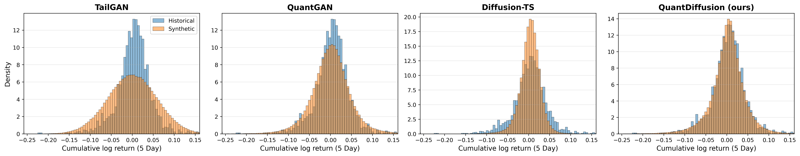

# QuantDiffusion (ICAIF 2026)

This is the official implementation of the paper: **QuantDiffusion: Multivariate Financial Scenario
Generation for Portfolio Risk Assessment via Realized Volatility Decomposition**.

---

## Our Paper

*QuantDiffusion: Multivariate Financial Scenario Generation for Portfolio Risk Assessment via Realized
Volatility Decomposition.* In the 7th ACM International Conference on AI in Finance (ICAIF), 2026.
Author list withheld for review.

We study how to make **denoising diffusion models** generate realistic multivariate financial return
scenarios for risk-sensitive tasks (stress testing, deep hedging, Value-at-Risk / Expected Shortfall
estimation), where reproducing the **tail** of the distribution matters as much as the bulk.

GAN-based generators reproduce stylized facts but admit no stochastic-process (SDE) interpretation, whereas
diffusion models are intrinsically SDEs but fail to model ordinary and tail events simultaneously. Reading
diffusion training as **Langevin dynamics**, we show that a stochastic-volatility process leaves a Brownian
footprint indistinguishable from the injected diffusion noise, and we remove this conflation by extracting the
volatility component **before** training. The resulting model stays coherent with a **stochastic volatility
jump diffusion (SVJD)** reading of returns, and consistently improves cross-asset dependence, marginal
distributions across horizons, volatility clustering, and portfolio-level VaR/ES over state-of-the-art
baselines.

**Contributions.**
1. The first to connect diffusion-model training with the SDE representation of financial time series, and a
   **realized-volatility decomposition** that models bulk and tail stably and concurrently.
2. An SDE-level (Itô-based) treatment of the **Lambert *W*** Gaussianization that isolates the jump component
   and restores stochastic-process interpretability, supporting the SVJD specification a posteriori.
3. A **DMS-TCN** backbone with dilated causal convolutions and parallel large/small-kernel branches for local
   and long-horizon dependence, with markedly lower portfolio VaR/ES error.

## QuantDiffusion Pipeline

Each return is factored into a standardized shock `z` and a volatility magnitude `√RV`, and the diffusion model
only ever sees the components:

```
Real returns  r ∈ R^{n×T}
      │   RV decomposition:  r_t = z_t · √RV_t     (RV = 10-day close-to-close realized variance)
      ▼
   (z, RV) ∈ R^{2n×T}
      │   Normalize  →  inverse Lambert W (Gaussianize z)  →  Normalize
      ▼
   Forward noising  q(x_t | x_{t-1})           DDPM, Student-t prior, cosine (ANT) schedule
      │   Reverse  p_θ(x_{t-1} | x_t)           score network = DMS-TCN
      ▼
   (ẑ, R̂V)  →  Denormalize → Lambert W → Denormalize
      │   Recomposition:  r̂_t = ẑ_t · √R̂V_t
      ▼
Synthetic returns  r̂ ∈ R^{n×T}
```

- **RV decomposition** decouples the coupled `(r, v)` SDE (via Itô) so the shock channel's diffusion depends
  only on `z`, flattening the energy landscape and stabilizing reverse-time Langevin dynamics. Statistically,
  `r = z·√RV` mirrors a Student-*t* variate, realizing a **dynamic Student-*t*** with a learned scale process.
- **Lambert *W*** Gaussianization tames the heavy tail of `z`; being `C²` and invertible, it acts at the SDE
  level (suppressing the jump term) rather than as a preprocessing heuristic.
- **DMS-TCN** (`models/DMS_TCN.py`, class `DMSTCN`): large-kernel branch (dilations `[1, 4, 16]`) + small-kernel
  branch, fused for multi-scale temporal structure.
- **Noise structure**: `ℓ1` loss, Student-*t* prior, cosine schedule (`τ=1.5`, `β∈[1e-5, 0.5]`, `T=75`, 45 epochs).

## Main Results

Real daily returns for six assets (DJIA, Nasdaq, JP Morgan, Hang Seng, Gold, WTI crude), 2001–2025, evaluated
against **TailGAN, QuantGAN, and Diffusion-TS**.



Best in **bold**, second best in *italic*; lower is better.

### Statistical fidelity

| Metric | TailGAN | QuantGAN | Diffusion-TS | QuantDiffusion |
|---|---|---|---|---|
| CCF(τ=0)  | 0.1987 | 0.0968 | **0.0533** | *0.0572* |
| CCF(τ>0)  | 0.0666 | 0.0569 | *0.0367* | **0.0341** |
| KS(1)     | 0.1820 | *0.0402* | 0.0948 | **0.0375** |
| KS(5)     | 0.1759 | *0.0529* | 0.1141 | **0.0418** |
| KS(20)    | 0.1823 | *0.0785* | 0.1335 | **0.0530** |
| KS(100)   | 0.2425 | *0.1404* | 0.1912 | **0.1403** |
| Skew(1)   | 0.2245 | 0.4560 | **0.1507** | *0.1582* |
| Skew(5)   | *0.2683* | 0.3424 | **0.1436** | 0.3335 |
| Skew(20)  | 0.2760 | *0.2277* | **0.2043** | 0.3380 |
| Skew(100) | 0.1262 | **0.0853** | *0.0955* | 0.1199 |
| Kurt(1)   | 4.2878 | 5.1508 | *2.9343* | **0.7942** |
| Kurt(5)   | 1.6039 | *0.9097* | 1.0401 | **0.8688** |
| Kurt(20)  | 0.7140 | *0.5001* | 0.6869 | **0.2287** |
| Kurt(100) | 0.2637 | 0.2678 | *0.2555* | **0.2037** |
| ACF(x)    | 0.0010 | 0.0012 | **0.0007** | *0.0008* |
| ACF(\|x\|) | 0.0051 | *0.0038* | 0.0041 | **0.0015** |
| ACF(x²)   | 0.0030 | *0.0023* | 0.0023 | **0.0009** |
| Leverage  | 0.0016 | *0.0011* | 0.0012 | **0.0007** |

### Portfolio risk (relative error over four trading strategies)

| Metric | TailGAN | QuantGAN | Diffusion-TS | QuantDiffusion |
|---|---|---|---|---|
| RE VaR(0.05)  | 0.5343 | *0.5340* | 0.5684 | **0.3514** |
| RE VaR(0.025) | 0.5278 | 0.5951 | *0.4797* | **0.3259** |
| RE VaR(0.01)  | 0.5605 | 0.6745 | *0.4110* | **0.3351** |
| RE ES(0.05)   | 0.5429 | 0.6346 | *0.4527* | **0.3276** |
| RE ES(0.025)  | 0.5842 | 0.7237 | *0.3995* | **0.3277** |
| RE ES(0.01)   | 0.6572 | 0.8619 | *0.3622* | **0.3388** |

QuantDiffusion is best on 12 of 17 fidelity metrics and top-2 on 15, and it attains the smallest VaR/ES error
at every confidence level, staying nearly flat rather than degrading deeper into the tail.

### Ablation

Removing one component at a time (best in **bold**, second best *italic*; lower is better).

**Statistical fidelity**

| Metric | Full | w/o RV Decomp. | w/o LambertW | w/o DMS-TCN |
|---|---|---|---|---|
| CCF(τ=0)  | 0.0572 | *0.0524* | 0.0709 | **0.0390** |
| CCF(τ>0)  | *0.0341* | 0.0342 | 0.0420 | **0.0276** |
| KS(1)     | 0.0375 | **0.0328** | 0.0379 | *0.0342* |
| KS(5)     | **0.0418** | 0.0446 | 0.0437 | *0.0424* |
| KS(20)    | **0.0530** | 0.0647 | *0.0622* | 0.0660 |
| KS(100)   | 0.1403 | **0.1300** | 0.1722 | *0.1399* |
| Skew(1)   | 0.1582 | **0.0845** | *0.1520* | 0.1920 |
| Skew(5)   | 0.3335 | *0.2032* | 0.3393 | **0.1076** |
| Skew(20)  | 0.3380 | *0.2143* | 0.3579 | **0.1616** |
| Skew(100) | 0.1199 | **0.0818** | 0.1155 | *0.0893* |
| Kurt(1)   | *0.7942* | 1.6739 | 0.8877 | **0.7817** |
| Kurt(5)   | 0.8688 | *0.4753* | 0.9116 | **0.4427** |
| Kurt(20)  | **0.2287** | 0.5363 | *0.2997* | 0.3646 |
| Kurt(100) | *0.2037* | 0.2313 | **0.1690** | 0.2536 |
| ACF(x)    | *0.0008* | 0.0008 | 0.0009 | **0.0007** |
| ACF(\|x\|) | **0.0015** | 0.0039 | 0.0021 | *0.0018* |
| ACF(x²)   | **0.0009** | 0.0024 | *0.0012* | 0.0012 |
| Leverage  | **0.0007** | 0.0010 | *0.0009* | 0.0010 |

**Portfolio risk**

| Metric | Full | w/o RV Decomp. | w/o LambertW | w/o DMS-TCN |
|---|---|---|---|---|
| RE VaR(0.05)  | **0.3514** | 0.6559 | *0.3814* | 0.4055 |
| RE VaR(0.025) | **0.3259** | 0.6278 | *0.3543* | 0.3716 |
| RE VaR(0.01)  | **0.3351** | 0.6131 | *0.3582* | 0.3676 |
| RE ES(0.05)   | **0.3276** | 0.6216 | *0.3546* | 0.3696 |
| RE ES(0.025)  | **0.3277** | 0.6045 | *0.3490* | 0.3565 |
| RE ES(0.01)   | **0.3388** | 0.5797 | 0.3534 | *0.3453* |

The RV decomposition is the dominant driver of tail-risk fidelity; the Lambert *W* transform is a secondary but
consistent contributor.

## Get Started

**1. Install dependencies.**

```bash
pip install -r requirements.txt
```

Install the PyTorch build that matches your CUDA. The main model / QuantGAN / TailGAN were run on
`torch==1.9.0+cu111`; the Diffusion-TS baseline uses PyTorch 2.x.

**2. Get results.** Open a notebook (`1_ablation_study.ipynb`, `2_benchmark.ipynb`, `3_visualization.ipynb`)
and run it top to bottom. The generation stage is **tiered**, so what you get depends on what you delete first:

| Starting point | What happens when you run the notebook |
|---|---|
| **Run as-is** | reuses the existing synthetic data and **prints the results** |
| **Delete** `result/statistics/synthetic_data/<tag>/*.npy` | **regenerates** scenarios from the saved weight, then results |
| **Also delete** `result/statistics/synthetic_data/<tag>/quantDiffusion_best*.pt` | **trains from scratch**, then generates, then results |

`<tag>` is `baseline` for QuantDiffusion and `wo_rv` / `wo_lambertw` / `wo_moderntcn` for the ablations.
So: run to reproduce, delete the `.npy` to re-sample, delete the weight to retrain.

**3. Retrain the baselines.** QuantGAN, TailGAN, and Diffusion-TS are trained from their own scripts under
`modules/`; rerun `2_benchmark.ipynb` afterwards to compare against the freshly generated baselines.

```bash
python modules/QuantGAN/run.py       # QuantGAN
python modules/TailGAN/run.py        # TailGAN
python modules/diffusionTS/run.py    # Diffusion-TS
```

**4. Portfolio VaR/ES artifacts.** The TailGAN-style risk metric needs `data/TailGAN/` (rolling windows +
thresholds + transition matrix). These are **built automatically** the first time you run
`1_ablation_study.ipynb` or `2_benchmark.ipynb`: `build_windows()` (imported from `modules/TailGAN/run.py`)
creates the rolling windows if missing, the transition matrix is auto-created, and the thresholds are computed
on first use. No separate step is required.

**5. Figures & data check.** `3_visualization.ipynb` saves ACF / correlation / histogram figures to
`result/images/` and cross-checks the CRSP dataset against yfinance.

**6. Noise schedule (optional).** `ANT_score.ipynb` scores noise schedules with the ANT criterion; this is how
the cosine schedule was selected.

### Data validation

The dataset is sourced from CRSP; `3_visualization.ipynb` cross-checks it against public yfinance data. The
index and commodity series match closely, while JP Morgan shows a minor difference (source/adjustment
conventions).

## Repository layout

```
quantDiffusion/
├── 1_ablation_study.ipynb   # QuantDiffusion (baseline) + 3 ablations: train / generate / evaluate
├── 2_benchmark.ipynb        # QuantDiffusion vs QuantGAN / TailGAN / Diffusion-TS
├── 3_visualization.ipynb    # ACF / correlation / histogram figures + CRSP-vs-yfinance check
├── ANT_score.ipynb          # ANT noise-schedule scoring
├── models/                  # DMS_TCN.py (DMSTCN), quantTCN.py
├── modules/                 # diffusion.py + baselines (QuantGAN, TailGAN, diffusionTS)
│   └── TailGAN/tailgan_eval.py    # portfolio VaR/ES metric
├── utils/                   # metric.py, file_manager.py, gaussianize.py, ANT_utils.py, ...
├── data/                    # indices.csv (CRSP), RV/, TailGAN/ (auto-built by the notebooks)
└── result/                  # statistics/synthetic_data/, statistics/*.csv, images/
```

Summary CSVs are grouped by prefix: `individual__<tag>__gen_quality.csv` (per model),
`ablation__*.csv`, and `benchmark__*.csv`.

## Code ↔ paper mapping

| Paper | Code |
|---|---|
| QuantDiffusion (ours) | tag `baseline`, RV = Close-to-Close, window = 10 |
| RV decomposition `r = z·√RV` | `fit_transform_garch_12d` (in `1_ablation_study.ipynb`) |
| Lambert *W* Gaussianization | `utils/gaussianize.py`, `scaling`/`inverse_scaling` in `utils/utils.py` |
| DMS-TCN | `models/DMS_TCN.py` (`DMSTCN`) |
| Diffusion (DDPM, Student-*t* prior) | `modules/diffusion.py` |
| Ablations (w/o RV Decomp. / LambertW / DMS-TCN) | tags `wo_rv` / `wo_lambertw` / `wo_moderntcn` |
| Portfolio VaR/ES | `modules/TailGAN/tailgan_eval.py` |
| Statistical fidelity metrics | `utils/metric.py` |
| ANT noise schedule | `ANT_score.ipynb`, `utils/ANT_utils.py` |

## Citation

```bibtex
@inproceedings{kim2026quantdiffusion,
  title     = {QuantDiffusion: Multivariate Financial Scenario Generation for
               Portfolio Risk Assessment via Realized Volatility Decomposition},
  author    = {Anonymous},
  booktitle = {Proceedings of the 7th ACM International Conference on AI in Finance (ICAIF)},
  year      = {2026},
}
```
