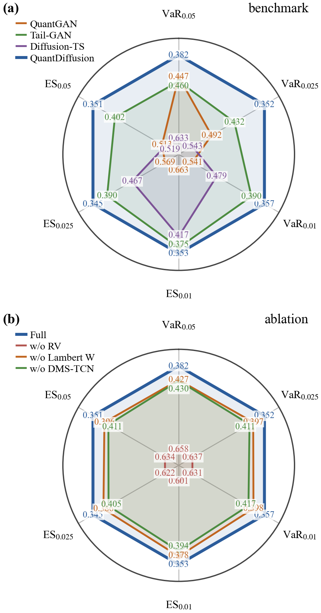

# QuantDiffusion (ICAIF 2026)

This is the official implementation of the paper: **QuantDiffusion: Multivariate Financial Scenario
Generation for Portfolio Risk Assessment via Realized Volatility Decomposition**.

---

## Our Paper

*QuantDiffusion: Multivariate Financial Scenario Generation for Portfolio Risk Assessment via Realized
Volatility Decomposition.* In the 7th ACM International Conference on AI in Finance (ICAIF), 2026.
Author list withheld for review.

We study how to make **denoising diffusion models** generate realistic multivariate financial return
scenarios for risk-sensitive tasks (stress testing, deep hedging, Value-at-Risk / Expected Shortfall
estimation), where reproducing the **tail** of the distribution matters as much as the bulk.

GAN-based generators reproduce stylized facts but admit no stochastic-process (SDE) interpretation, whereas
diffusion models are intrinsically SDEs but fail to model ordinary and tail events simultaneously. Reading
diffusion training as **Langevin dynamics**, we show that a stochastic-volatility process leaves a Brownian
footprint indistinguishable from the injected diffusion noise, and we remove this conflation by extracting the
volatility component **before** training. The resulting model stays coherent with a **stochastic volatility
jump diffusion (SVJD)** reading of returns, and consistently improves cross-asset dependence, marginal
distributions across horizons, volatility clustering, and portfolio-level VaR/ES over state-of-the-art
baselines.

**Contributions.**
1. The first to connect diffusion-model training with the SDE representation of financial time series, and a
   **realized-volatility decomposition** that models bulk and tail stably and concurrently.
2. An SDE-level (Itô-based) treatment of the **Lambert *W*** Gaussianization that isolates the jump component
   and restores stochastic-process interpretability, supporting the SVJD specification a posteriori.
3. A **DMS-TCN** backbone with dilated causal convolutions and parallel large/small-kernel branches for local
   and long-horizon dependence, with markedly lower portfolio VaR/ES error.

## QuantDiffusion Pipeline

Each return is factored into a standardized shock `z` and a volatility magnitude `√RV`, and the diffusion model
only ever sees the components:

```
Real returns  r ∈ R^{n×T}
      │   RV decomposition:  r_t = z_t · √RV_t     (RV = 10-day close-to-close realized variance)
      ▼
   (z, RV) ∈ R^{2n×T}
      │   Normalize  →  inverse Lambert W (Gaussianize z)  →  Normalize
      ▼
   Forward noising  q(x_t | x_{t-1})           DDPM, Student-t prior, cosine (ANT) schedule
      │   Reverse  p_θ(x_{t-1} | x_t)           score network = DMS-TCN
      ▼
   (ẑ, R̂V)  →  Denormalize → Lambert W → Denormalize
      │   Recomposition:  r̂_t = ẑ_t · √R̂V_t
      ▼
Synthetic returns  r̂ ∈ R^{n×T}
```

- **RV decomposition** decouples the coupled `(r, v)` SDE (via Itô) so the shock channel's diffusion depends
  only on `z`, flattening the energy landscape and stabilizing reverse-time Langevin dynamics. Statistically,
  `r = z·√RV` mirrors a Student-*t* variate, realizing a **dynamic Student-*t*** with a learned scale process.
- **Lambert *W*** Gaussianization tames the heavy tail of `z`; being `C²` and invertible, it acts at the SDE
  level (suppressing the jump term) rather than as a preprocessing heuristic.
- **DMS-TCN** (`models/DMS_TCN.py`, class `DMSTCN`): large-kernel branch (dilations `[1, 4, 16]`) + small-kernel
  branch, fused for multi-scale temporal structure.
- **Noise structure**: `ℓ1` loss, Student-*t* prior, cosine schedule (`τ=1.5`, `β∈[1e-5, 0.5]`, `T=75`, 45 epochs).

## Main Results

Real daily returns for six assets (DJIA, Nasdaq, JP Morgan, Hang Seng, Gold, WTI crude), 2001–2025, evaluated
against **QuantGAN, Tail-GAN, and Diffusion-TS**.



Best in **bold**, second best in *italic*; lower is better. Every number below is read straight out of
`result/statistics/*.csv`, which the notebooks regenerate.

### Statistical fidelity

| Metric | QuantGAN | Tail-GAN | Diffusion-TS | QuantDiffusion |
|---|---|---|---|---|
| CCF(τ=0) | 0.0968 | 0.1822 | **0.0533** | *0.0572* |
| CCF(τ>0) | 0.0569 | 0.0798 | *0.0367* | **0.0341** |
| Vol CCF(τ=0) | 0.1409 | 0.3072 | **0.0631** | *0.0818* |
| KS(1) | *0.0402* | 0.1482 | 0.0948 | **0.0375** |
| KS(5) | *0.0529* | 0.1195 | 0.1141 | **0.0418** |
| KS(20) | *0.0785* | 0.1620 | 0.1335 | **0.0530** |
| KS(100) | *0.1404* | 0.2603 | 0.1912 | **0.1403** |
| Skew(1) | 0.4560 | 0.2700 | **0.1507** | *0.1582* |
| Skew(5) | 0.3424 | 0.4445 | **0.1436** | *0.3335* |
| Skew(20) | *0.2277* | 0.4584 | **0.2043** | 0.3380 |
| Skew(100) | **0.0853** | 0.3290 | *0.0955* | 0.1199 |
| Kurt(1) | 5.1508 | 4.6610 | *2.9343* | **0.7942** |
| Kurt(5) | *0.9097* | 1.0891 | 1.0401 | **0.8688** |
| Kurt(20) | *0.5001* | 0.5923 | 0.6869 | **0.2287** |
| Kurt(100) | 0.2678 | 0.6255 | *0.2555* | **0.2037** |
| ACF(x) | 0.0012 | 0.0033 | **0.0007** | *0.0008* |
| ACF(\|x\|) | *0.0038* | 0.0059 | 0.0041 | **0.0015** |
| ACF(x²) | *0.0023* | 0.0037 | 0.0023 | **0.0009** |
| Leverage | *0.0011* | 0.0037 | 0.0012 | **0.0007** |

### Portfolio risk (relative error over four trading strategies)

| Metric | QuantGAN | Tail-GAN | Diffusion-TS | QuantDiffusion |
|---|---|---|---|---|
| RE VaR(0.05) | *0.4468* | 0.4604 | 0.6333 | **0.3815** |
| RE VaR(0.025) | 0.4925 | *0.4320* | 0.5434 | **0.3525** |
| RE VaR(0.01) | 0.5412 | *0.3899* | 0.4790 | **0.3566** |
| RE ES(0.05) | 0.5126 | *0.4020* | 0.5195 | **0.3507** |
| RE ES(0.025) | 0.5693 | *0.3895* | 0.4670 | **0.3455** |
| RE ES(0.01) | 0.6627 | *0.3752* | 0.4168 | **0.3533** |

QuantDiffusion is best on 12 of 19 fidelity metrics and top-2 on 17, and it attains the smallest VaR/ES error
at every confidence level, staying nearly flat rather than degrading deeper into the tail.

Tail-GAN is the informative comparison. Its quantile based adversarial objective makes it the second best model
on five of the six risk entries, and the only baseline whose VaR error *falls* as the confidence level tightens
(0.4604 → 0.4320 → 0.3899), yet it is the weakest of the four on cross correlation, on KS, and on every
clustering metric. Distributional fidelity and tail risk fidelity are distinct objectives, and QuantDiffusion is
the only model here that leads on both.

### Ablation

Removing one component at a time (best in **bold**, second best *italic*; lower is better).

**Statistical fidelity**

| Metric | Full | w/o RV Decomp. | w/o Lambert W | w/o DMS-TCN |
|---|---|---|---|---|
| CCF(τ=0)  | 0.0572 | *0.0524* | 0.0709 | **0.0390** |
| CCF(τ>0)  | *0.0341* | 0.0342 | 0.0420 | **0.0276** |
| Vol CCF(τ=0) | *0.0818* | 0.1432 | 0.1151 | **0.0568** |
| KS(1)     | 0.0375 | **0.0328** | 0.0379 | *0.0342* |
| KS(5)     | **0.0418** | 0.0446 | 0.0437 | *0.0424* |
| KS(20)    | **0.0530** | 0.0647 | *0.0622* | 0.0660 |
| KS(100)   | 0.1403 | **0.1300** | 0.1722 | *0.1399* |
| Skew(1)   | 0.1582 | **0.0845** | *0.1520* | 0.1920 |
| Skew(5)   | 0.3335 | *0.2032* | 0.3393 | **0.1076** |
| Skew(20)  | 0.3380 | *0.2143* | 0.3579 | **0.1616** |
| Skew(100) | 0.1199 | **0.0818** | 0.1155 | *0.0893* |
| Kurt(1)   | *0.7942* | 1.6739 | 0.8877 | **0.7817** |
| Kurt(5)   | 0.8688 | *0.4753* | 0.9116 | **0.4427** |
| Kurt(20)  | **0.2287** | 0.5363 | *0.2997* | 0.3646 |
| Kurt(100) | *0.2037* | 0.2313 | **0.1690** | 0.2536 |
| ACF(x)    | *0.0008* | 0.0008 | 0.0009 | **0.0007** |
| ACF(\|x\|) | **0.0015** | 0.0039 | 0.0021 | *0.0018* |
| ACF(x²)   | **0.0009** | 0.0024 | *0.0012* | 0.0012 |
| Leverage  | **0.0007** | 0.0010 | *0.0009* | 0.0010 |

**Portfolio risk**

| Metric | Full | w/o RV Decomp. | w/o Lambert W | w/o DMS-TCN |
|---|---|---|---|---|
| RE VaR(0.05) | **0.3815** | 0.6578 | *0.4271* | 0.4299 |
| RE VaR(0.025) | **0.3525** | 0.6372 | *0.3969* | 0.4115 |
| RE VaR(0.01) | **0.3566** | 0.6313 | *0.3984* | 0.4175 |
| RE ES(0.05) | **0.3507** | 0.6338 | *0.3956* | 0.4113 |
| RE ES(0.025) | **0.3455** | 0.6221 | *0.3857* | 0.4053 |
| RE ES(0.01) | **0.3533** | 0.6009 | *0.3776* | 0.3936 |

The RV decomposition is the dominant driver of tail-risk fidelity; the Lambert *W* transform is a secondary but
consistent contributor.

## Get Started

**1. Install dependencies.**

```bash
pip install -r requirements.txt
```

Install the PyTorch build that matches your CUDA. The main model / QuantGAN / Tail-GAN were run on
`torch==1.9.0+cu111`; the Diffusion-TS baseline uses PyTorch 2.x.

**2. Get results.** Open a notebook (`1_ablation_study.ipynb`, `2_benchmark.ipynb`, `3_visualization.ipynb`)
and run it top to bottom. The generation stage is **tiered**, so what you get depends on what you delete first:

| Starting point | What happens when you run the notebook |
|---|---|
| **Run as-is** | reuses the existing synthetic data and **prints the results** |
| **Delete** `result/statistics/synthetic_data/<tag>/*.npy` | **regenerates** scenarios from the saved weight, then results |
| **Also delete** `result/statistics/synthetic_data/<tag>/quantDiffusion_best*.pt` | **trains from scratch**, then generates, then results |

`<tag>` is `baseline` for QuantDiffusion and `wo_rv` / `wo_lambertw` / `wo_moderntcn` for the ablations.
So: run to reproduce, delete the `.npy` to re-sample, delete the weight to retrain.

**3. Retrain the baselines.** QuantGAN, Tail-GAN, and Diffusion-TS are trained from their own scripts under
`modules/`; rerun `2_benchmark.ipynb` afterwards to compare against the freshly generated baselines.

```bash
python modules/QuantGAN/run.py       # QuantGAN
python modules/diffusionTS/run.py    # Diffusion-TS

# Tail-GAN. The reported column comes from this command.
python modules/TailGAN/run.py --train --sets 5 --ensemble 1 --epochs 2000 \
    --lr-g 1e-4 --lr-d 1e-5 --d-warmup 400 --lr-d-warmup 1e-3 --select vares
```

> **Tail-GAN does not train at its published defaults on this data, so `run.py` grew four flags.** The
> generator's loss is `S(D(fake), real PnL)`, so it only carries signal once the discriminator is a working
> VaR/ES estimator. The discriminator's own objective is `real_score - fake_score`, which it can lower by
> inflating `fake_score` instead of becoming accurate, and at `lr_D <= 1e-5` that is what happens: it stays at
> its random initialization, and from a random critic the generator's loss *falls monotonically in the generated
> volatility*, telling it to be more extreme without bound. Measured here: `loss_G` 8.43 at 0.2x volatility down
> to 8.35 at 2x, against an attainable floor of 2.11, with per asset standard deviations frozen at 0.027 for all
> six assets. `--d-warmup 400 --lr-d-warmup 1e-3` trains the critic alone first, which reaches the floor
> (1.90 against 1.89) in a hundred steps and turns the generator's loss into a bowl whose minimum sits at the
> real volatility. `train_single_warm` in `run.py` also logs `real_score` and the empirical floor separately,
> which the upstream logging hides by reporting only their difference.
>
> The ten model ensemble of the original paper was also run (`--ensemble 10`). Screening dropped four collapsed
> models and both the original criterion and the `--screen-by min` variant kept the same five, but pooling five
> generators was worse than the single model on **all six** risk entries, by 8% to 29%, because mixing
> heterogeneous generators widens the pooled distribution and inflates the tail quantiles. The reported column is
> therefore the single generator, chosen on the training data selection criterion Tail-GAN itself defines
> (`vares` 0.0886 against 0.0938 to 0.1173 for the ensemble members), not on test numbers.

**4. Portfolio VaR/ES artifacts.** The TailGAN-style risk metric needs `data/TailGAN/` (rolling windows +
thresholds + transition matrix). These are **built automatically** the first time you run
`1_ablation_study.ipynb` or `2_benchmark.ipynb`: `build_windows()` (imported from `modules/TailGAN/run.py`)
creates the rolling windows if missing, the thresholds are computed on first use, and the transition matrix is
restored from `data/tailgan_basket/`. No separate step is required.

> **The transition matrix is the evaluation basket, so it is version controlled.** Fifty of the sixty eight
> P&L columns in `Compute_PNL` are static portfolios drawn by `Gen_StaticPort`, which samples from an unseeded
> normal. Drawing a new matrix rescores **every** model at once, including models that were not retrained, and
> by enough to matter: one accidental redraw moved QuantGAN's `RE_VaR(0.05)` from 0.5340 to 0.4468 and
> Diffusion-TS's from 0.5684 to 0.6333 from byte identical samples. `data/TailGAN/` is not tracked, so the
> matrix itself is kept at `data/tailgan_basket/LShort_Stk6/` and
> `tailgan_eval.ensure_static_basket` copies it into place; a seed alone would not be enough, since
> `scipy.sparse.random` is not guaranteed stable across scipy versions. The reported risk numbers reproduce
> only against this basket. Replacing it is a deliberate act, and every number in the tables moves with it.

**5. Figures & data check.** `3_visualization.ipynb` saves ACF / correlation / histogram figures to
`result/images/` and cross-checks the CRSP dataset against yfinance.

The five figures the paper uses are separate, built by `utils/make_paper_figures.py` straight into
`result/images/`, sized for `acmart` sigconf (3.33 in for one column, 7.0 in across both) at 400 dpi. Section
3-1 of `3_visualization.ipynb` calls the same builders, one cell per figure, so the notebook and the pdf cannot
show different plots.

```bash
python utils/make_paper_figures.py          # all five
python utils/make_paper_figures.py 2 4      # only fig2 and fig4
```

| File | Content |
|---|---|
| `fig1_stylized_facts.png` | ACF of \|r\| and r², and the distribution of cross asset comovement of the volatility channel over scenarios |
| `fig2_distribution.png` | five day cumulative log return distributions for JP Morgan |
| `fig3_risk_radars.png` | VaR/ES relative error, baselines and ablation |
| `fig4_risk_horizon.png` | VaR/ES error at every horizon from 20 to 255 trading days |
| `fig5_architecture.png` | the draw.io export, copied into place rather than redrawn |

`fig4` needs Tail-GAN's `Compute_PNL`, which corrupts the heap on CPU: the P&L values come out correct, then the
process dies at whatever allocates next. Each horizon is therefore computed in a subprocess that writes its
result and leaves through `os._exit`, cached under `result/images/pnl_cache/`, which is safe to delete and is
what makes a restyle take one second instead of two minutes. Set `CUDA_VISIBLE_DEVICES=-1` to keep it off a busy
GPU.

**6. Noise schedule (optional).** `ANT_score.ipynb` scores noise schedules with the ANT criterion; this is how
the cosine schedule was selected.

### Data validation

The dataset is sourced from CRSP; `3_visualization.ipynb` cross-checks it against public yfinance data. The
index and commodity series match closely, while JP Morgan shows a minor difference (source/adjustment
conventions).

## Repository layout

```
quantDiffusion/
├── 1_ablation_study.ipynb   # QuantDiffusion (baseline) + 3 ablations: train / generate / evaluate
├── 2_benchmark.ipynb        # QuantDiffusion vs QuantGAN / Tail-GAN / Diffusion-TS
├── 3_visualization.ipynb    # ACF / correlation / histogram figures + CRSP-vs-yfinance check
├── ANT_score.ipynb          # ANT noise-schedule scoring
├── models/                  # DMS_TCN.py (DMSTCN), quantTCN.py
├── modules/                 # diffusion.py + baselines (QuantGAN, TailGAN, diffusionTS)
│   └── TailGAN/tailgan_eval.py    # portfolio VaR/ES metric + ensure_static_basket
├── utils/                   # metric.py, file_manager.py, gaussianize.py, ANT_utils.py, ...
├── data/                    # indices.csv (CRSP), RV/, tailgan_basket/ (the evaluation basket),
│                            #   TailGAN/ (auto-built by the notebooks)
└── result/
    ├── statistics/          # synthetic_data/<tag>/*.npy, *.csv
    └── images/              # the five paper figures, drawio/ sources, pnl_cache/
```

`result/images/` is not tracked: the figures are rebuilt by `utils/make_paper_figures.py` or by notebook 3.

Summary CSVs are grouped by prefix: `individual__<tag>__gen_quality.csv` (per model),
`ablation__*.csv`, and `benchmark__*.csv`.

## Code ↔ paper mapping

| Paper | Code |
|---|---|
| QuantDiffusion (ours) | tag `baseline`, RV = Close-to-Close, window = 10 |
| RV decomposition `r = z·√RV` | `fit_transform_garch_12d` (in `1_ablation_study.ipynb`) |
| Lambert *W* Gaussianization | `utils/gaussianize.py`, `scaling`/`inverse_scaling` in `utils/utils.py` |
| DMS-TCN | `models/DMS_TCN.py` (`DMSTCN`) |
| Diffusion (DDPM, Student-*t* prior) | `modules/diffusion.py` |
| Ablations (w/o RV Decomp. / LambertW / DMS-TCN) | tags `wo_rv` / `wo_lambertw` / `wo_moderntcn` |
| Portfolio VaR/ES | `modules/TailGAN/tailgan_eval.py` |
| Statistical fidelity metrics | `utils/metric.py` |
| ANT noise schedule | `ANT_score.ipynb`, `utils/ANT_utils.py` |

## Citation

```bibtex
@inproceedings{kim2026quantdiffusion,
  title     = {QuantDiffusion: Multivariate Financial Scenario Generation for
               Portfolio Risk Assessment via Realized Volatility Decomposition},
  author    = {Anonymous},
  booktitle = {Proceedings of the 7th ACM International Conference on AI in Finance (ICAIF)},
  year      = {2026},
}
```
